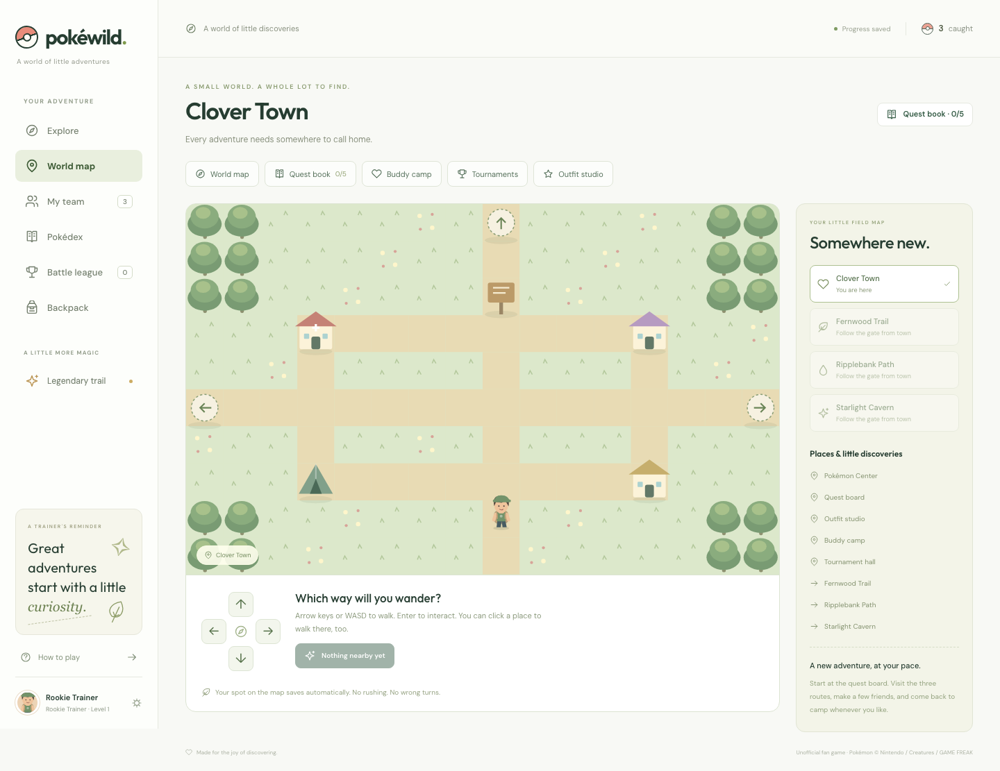

# Pokéwild

A little curiosity. A wild adventure.

**[Play Pokéwild in your browser](https://anniehu824.github.io/pokewild/)**

An unofficial Pokémon fan game with all 1,025 species, evolution, Mega Evolution, Gigantamax, gyms, quests, shiny Pokémon, and tournaments.



## Play

Open **index.html** in a modern browser. Everything is included: no account, installation, internet connection, or API key is needed. If you downloaded the ZIP, extract the whole folder first and keep its files together.

**Bringing an existing adventure online:** open Trainer settings in your local game and choose **Export adventure**. Then open the online game, choose **Import adventure** in Trainer settings, and select that backup. Saves are stored separately for each browser and site address.

You start with **Bulbasaur, Charmander, and Squirtle**, all at level 8.

1. **Explore** a habitat for a surprise encounter, or use the **Pokédex** to find a particular Pokémon.
2. Choose battle moves to lower its HP. **Gentle tap** always leaves at least 1 HP, even against Ghost Pokémon.
3. Throw a **Poké Ball**. The game shows your current catch chance. Basic Poké Balls are unlimited.
4. Use **My team** to choose your starting partner, bring up to six Pokémon, and swap anyone with your collection at camp.
5. **Heal team** or visit **Backpack** to heal every Pokémon and restock to at least eight Potions and five Great Balls, for free.
6. Look for **Ready to evolve** in My team or the results after a battle. Choose the next form, or wait and evolve later.
7. Open **Battle league** to challenge gym leaders for badges or other trainers for useful loot.
8. Visit **World map** to walk through Clover Town and three routes, follow quests, and find treasure.
9. Spend time at **Buddy camp**, choose new battle moves, enter tournaments, or visit the **Outfit studio**.
10. Try **Mega Evolve** or **Gigantamax** during battle with an eligible buddy. **My team → Explore battle forms** shows the full roster.

## Mega Evolution and Gigantamax

The battle-form guide contains **97 Mega form choices across 87 species** and **34 Gigantamax choices across 32 species**, including alternate styles and the newer Mega forms in the public Pokémon dataset. Every form includes normal and shiny artwork. Forms are temporary choices for your existing Pokémon; they do not create extra collectible species.

- **Choose one transformation per battle:** either Mega Evolution or Gigantamax, for one teammate. It is free to activate, then you choose your move. The limit covers a trainer’s entire opposing team; each tournament round gets a fresh use.
- **Mega Evolution** uses the form’s base battle stats and types. It lasts until that Pokémon faints or the battle ends, and stays active when switching out and back. HP and your equipped moves stay the same. Charizard and Mewtwo have separate X and Y choices; other alternate Mega forms appear in the chooser too.
- **Gigantamax** doubles current and maximum HP and turns attacks into stronger Max moves for **three turns**. Max moves gain 30% power and have no recharge while transformed. An attack matching the form’s signature type becomes its **G-Max move**. If your moves lack that type, the first attack becomes the signature move instead. The controls show attack power so you can distinguish stronger attacks.
- Attacking, healing, reviving, and failed captures each use a Gigantamax turn. Knocking out one member of a trainer’s team also counts. Switching out, fainting, finishing the battle, leaving, or reloading ends Gigantamax. Remaining HP returns to ordinary units, rounded up; the transformation never provides permanent healing.
- **Gentle tap stays gentle**, including while Gigantamaxed. It still leaves wild Pokémon with at least 1 HP. Trainer Pokémon still cannot be captured.
- All eligible Pokémon can use their forms immediately: no Mega Stones, Max Soup, extra levels, or special currency. Bulbasaur, Charmander, and Squirtle first need to evolve into Venusaur, Charizard, and Blastoise; each of those final starter forms can use either feature. Pikachu and Eevee can Gigantamax directly.
- The guide is available from My team and eligible Pokédex detail screens. Existing saves work automatically, with no reset or permanent changes to species, XP, friendship, shininess, or chosen moves.

These are simplified Pokéwild rules. Mega stats and form types affect the existing damage system; special abilities and weather/status effects are not simulated. Alternate appearance and fighting styles are selectable under the same collected species.

## Clover Town and three routes

Use **arrow keys**, **WASD**, the direction buttons, or click a location to walk there. Press **Enter** or **Interact** when something is nearby. Clicking a named place in the field map walks there and interacts automatically. Trees, rocks, and water block the way; paths and bridges lead around them.

- **Clover Town:** a Pokémon Center for free healing, quest board, Buddy camp, Outfit studio, and tournament hall.
- **Fernwood Trail:** Grass and woodland Pokémon, Ranger Rowan, hidden supplies, and a lost Eevee to help home.
- **Ripplebank Path:** Water Pokémon, a bridge across the river, Ace Kai, and riverside treasure.
- **Starlight Cavern:** cave Pokémon, crystals, Veteran Aria, and a glittering treasure chest.

Walk through a gate to visit a route for the first time. After discovering a place, its fast-travel button becomes available. Your position, visits, and opened treasure chests save automatically. Treasure is awarded once per chest.

Grass can trigger occasional encounters. **Look for Pokémon** starts an encounter from the route’s local species. After the battle, return to the same spot. The original Explore, Pokédex, and Legendary trail screens still let you encounter every species directly.

## Five starter quests

Open **Quest book** from the map or town board. Quests can be completed in any order, without deadlines. Claim each completed quest to receive its items and unlock its styles.

| Quest | Goal | Special reward |
| --- | --- | --- |
| Three paths, one adventure | Visit all three routes | Ranger outfit and Pathfinder title |
| A splash of friendship | Befriend three different Water species; earlier catches count | Ocean backpack |
| A little friend, a long way home | Find Eevee in Fernwood Trail, then return to town | Eevee joins the collection; Berry backpack |
| Better together | Reach 40 friendship with any Pokémon | Cozy outfit |
| A little courage | Win a trainer battle, gym battle, or tournament; earlier wins count | Rising Trainer title |

After claiming all five, claim a **guaranteed shiny Ponyta**. If your team is full, new Pokémon wait at camp. If you already have Eevee or Ponyta, the reward preserves their existing level and XP.

## Shiny friends

All 1,025 species have their actual alternate-color sprites bundled locally. Wild meetings have a **1 in 64 shiny chance**. After 79 consecutive non-shiny meetings, the next encounter is guaranteed shiny. This counter resets when a shiny appears; catching that encounter is still up to you. The quest reward provides a separate guaranteed shiny friendship.

Shiny Pokémon have the same battle strength as regular Pokémon. Catch one to keep its special colors, shown in battle, the team, and camp. Use the Pokédex’s **Shiny friends** tab to find shiny Pokémon currently in your collection.

The game keeps one entry per species. A shiny catch adds shiny colors to an existing entry without replacing its level, XP, or friendship. Later regular catches do not remove shiny colors. Shiny colors and history carry through evolution.

## Friendship and move training

At **Buddy camp**, choose any Pokémon from your collection, including those outside your travel team. Feeding gives **10 friendship**, petting gives **8**, and playing gives **12**. Food is free, friendship never decreases, and reaching 100 earns a **Best Buddy ribbon**.

Each activity is available once per outing for each Pokémon. Complete a battle or walk 20 map steps to refresh the activities. There are no real-time waits. Friendship stays with a Pokémon through evolution; combining existing forms keeps the higher friendship.

Choose **Choose moves** on a team card or **Choose battle moves** at camp to open the move notebook. Pick an unlocked move and the slot it should replace. Each Pokémon brings exactly four moves. Changes are free outside battle, and replaced moves can be equipped again.

- **Swift** unlocks at level 10 and **Rock Smash** at level 20.
- New attacks for each of the Pokémon’s types unlock at levels **12, 25, and 45**.
- Stronger attacks need two or three turns to recharge, as shown in the notebook and battle controls.
- **Gentle tap** is useful for catching. In trainer, gym, and tournament battles, its slot becomes **Steady Strike**, which can knock out an opponent.
- Evolving gives the new species its default moves and its own available move choices. Choose a new set from the notebook whenever you like.

This is a simplified move library designed for the game, rather than the official games’ complete learnsets or status-effect system.

## Tournaments and trainer style

The tournament hall offers three repeatable cups, each with three full-team matches:

| Cup | Division | Opponent levels | Final reward |
| --- | --- | --- | --- |
| Meadow Cup | Beginner | 10–14 | Trophy, 5 Ultra Balls, 3 Super Potions, 1 Revive, 3 Rare Candies, and 650 team XP |
| River Cup | Intermediate | 35–45 | Trophy, 9 Ultra Balls, 5 Super Potions, 3 Revives, 5 Rare Candies, and 1,800 team XP |
| Summit Cup | Champion | 80–100 | Trophy, 15 Ultra Balls, 8 Super Potions, 5 Revives, 8 Rare Candies, and 4,000 team XP |

Preview all three lineups before entering. Your team heals and basic supplies refill before every round. **Win all three rounds** to receive the trophy, items, and XP. Completed rounds save automatically. You can leave a match and resume that round, or pause between rounds. Losing ends the current run and heals your team; previously earned trophies and Pokémon stay safe. Only one cup run can be active at a time.

Visit **Outfit studio** from town, the adventure links, or Trainer settings. Choose outfit and backpack colors, a title, and a skin tone. Two outfits and two backpacks are available from the start. Quests unlock additional styles; your first shiny unlocks **Shiny Seeker**. Winning the Summit Cup unlocks the **Champion outfit** and **Cup Champion title**. Your appearance updates both the map character and trainer profile.

## Gyms, trainers, and rewards

The **Gym circuit** has eight gyms, from Brock’s level 10–12 team to Giovanni’s level 52–56 team. Each gym has its own Pokémon lineup and permanent badge. Choose any gym in any order; your badge case records all eight victories.

The **Trainer challenges** tab has eight opponents, ranging from Mia’s friendly level 9–10 team to Red’s six level 100 Pokémon. Lance, Cynthia, and a trainer with legendary Pokémon provide tougher battles along the way. Opponent levels stay fixed, so training, evolution, and choosing a suitable team matter.

- Preview every opponent’s full lineup, levels, type advice, and exact rewards before starting.
- Your collection is healed and basic Potions and Great Balls are restocked before each match. Your Pokémon keep their remaining HP as opponents send out their next teammates.
- Defeat the **entire opposing team** to win loot and XP for every travel buddy. Trainer-owned Pokémon cannot be captured.
- A first gym victory awards its badge and full supplies. Gym rematches give half the listed original item quantities, rounded up, and the same XP. Trainer rematches give full rewards. You can repeat challenges as often as you like.
- Losing heals your collection and preserves your Pokémon, levels, badges, and remaining items. Leaving or losing before the full team is beaten gives no victory rewards.

| Earned item | How to use it |
| --- | --- |
| **Ultra Ball** | Select it under **Your Poké Balls** in a wild encounter. It improves the base catch chance by 75%, compared with a Great Ball’s 35%; the displayed chance includes difficulty and limits. |
| **Super Potion** | Select it under **Healing item** during a battle. Restores the active Pokémon to full HP, then the opponent takes a turn. |
| **Revive** | Use **Revive a teammate** during battle to restore a fainted travel buddy to half HP. Another Pokémon must still be standing; using it takes a turn. |
| **Rare Candy** | Choose **Give a Rare Candy** in Backpack outside battle. One candy gives one travel buddy one level while preserving current XP, up to level 100. New evolution choices appear immediately when eligible. |

Premium items are earned through victories and are not replenished by free camp healing. The first gym is approachable with the original starter trio on Balanced difficulty. For later challenges, build a team near the opponent’s level, use type advantages, and heal or switch when needed. Gentle difficulty remains available for a more forgiving adventure.

## Evolution

All **484 species-to-species evolution paths** are included. Evolution changes the Pokémon in your collection, updates its stats and moves, and keeps its level, XP, and place on your team. A starting partner stays your partner after evolving.

| Starter | First evolution | Final evolution |
| --- | --- | --- |
| Bulbasaur | Ivysaur at level 16 | Venusaur at level 32 |
| Charmander | Charmeleon at level 16 | Charizard at level 36 |
| Squirtle | Wartortle at level 16 | Blastoise at level 36 |

- **You choose when.** Evolution becomes available at the required level. It is never forced. Older saves with Pokémon already above the requirement can evolve immediately through My team.
- **Branching forms are your choice.** Eevee can become any of its eight evolutions at level 20. Other branches, including Cosmoem’s two legendary evolutions, are available too.
- **Special evolutions use simple level goals.** Stone, friendship, trading, gender, regional-form, and other special requirements are simplified for this game. Pikachu can become Raichu at level 20; Haunter can become Gengar at 30. Each evolution screen shows its exact requirement. No items, real-world waits, or other players are needed.
- **Every stage remains recorded.** Earlier forms stay in the Pokédex’s Befriended tab, marked Recorded when you no longer have that form. You can catch them again to add them to your team.
- **One entry per species.** If you already own the evolved form, the evolution screen explains that the two entries will combine. The higher level, the greater XP at that level, and best health are kept. The team stays valid without duplicate species, and both forms remain recorded.
- Pokémon at camp can evolve too. Evolution does not heal a fainted Pokémon unless combining with an already-healthy evolved form; the free camp healing remains available.

## A friendly challenge

- The Pokédex contains all **1,025 species** from generations 1–9: 931 regular, 71 legendary, and 23 mythical Pokémon. Mega and Gigantamax forms are temporary battle transformations, not separate collectible species.
- Every species can be encountered directly from its Pokédex entry. Legendary and mythical Pokémon begin at level 12 or above, have stronger stats, and are harder to catch.
- Regular wild Pokémon scale to your partner’s level. Pick **Gentle**, **Balanced**, or **Brave** in Trainer settings. Balanced is the default; Gentle is a good option for younger children.
- Element types affect damage. The game shows which moves are effective. It uses a simplified set of four moves for each Pokémon, rather than the original games’ full move lists and status systems.
- Starting power moves need two turns to recharge; the strongest learned attacks need three. Potions restore 60% of maximum HP. Switching a healthy Pokémon or using a Potion takes a turn; switching after fainting is free.
- Repeated catching attempts at or below 25% HP eventually guarantee success: the third attempt for regular Pokémon, or the fifth for legendary and mythical Pokémon, at the latest. All failed attempts in the encounter count.
- Battling and catching award experience to your whole travel team. Levels are capped at 100. Evolved species can also be caught directly.
- Extra catches go to camp when your team is full. Catching a species you already own grants team experience without adding a duplicate.
- Losing heals the entire collection and refills supplies. Leaving an encounter is safe; collection, levels, and experience are kept.

## Keep your adventure

Progress saves in this browser on this device. Use the same browser and game address when returning. Opening the file directly and playing through a local server have separate saves.

Click the trainer profile or avatar to **Export adventure** as a JSON backup. Use **Import adventure** to restore it on another browser or device. Export before moving the game, clearing browser data, or changing its address. If browser storage is blocked, the game still runs and tells you to export manually.

An active battle is not resumed after reloading. Captured Pokémon, party choices, experience, HP, supplies, gym badges, trainer victories, map position, quests, shiny history, friendship, chosen moves, trophies, and outfits are saved. A paused tournament resumes at the first unfinished round. Existing saves gain the new features automatically without resetting progress. Exports include all these fields. There are no accounts, tracking, ads, purchases, or online multiplayer.

## Optional local server

For a consistent local address, open a terminal in the extracted `pokewild` folder and run:

```sh
python3 -m http.server 8765 --bind 127.0.0.1
```

Then visit <http://127.0.0.1:8765>. Keep the terminal open while playing.

## Included files

- `index.html`, `styles.css`, and `app.js`: interface, scenery, game controls, and local saving.
- `engine.js`: battle, catch, XP, evolution, rewards, and save-validation rules.
- `challenges.js`: gym leaders, trainer lineups, badges, and loot tables.
- `league.js`: challenge previews, badge case, results, and earned-item controls.
- `data.js`: the full local Pokédex and type-effectiveness chart.
- `evolutions.js`: all evolution paths and their level requirements.
- `adventure-data.js`: the four map areas, quests, cups, and customization choices.
- `adventure-engine.js`: map navigation, quests, friendship, shiny colors, moves, and compatible saving.
- `adventure.js` and `adventure.css`: the world map, camp, quest book, tournaments, and outfit studio.
- `transformations-data.js`, `transformations-engine.js`, `transformations.js`, and `transformations.css`: eligible Mega/Gigantamax forms, temporary battle rules, controls, and the searchable guide.
- `assets/`: all Pokémon sprites, selected official artwork, fonts, and font licenses.
- `CREDITS.md`: source and artwork attribution.

## Verification

Browser checks cover wild battles and captures, all eight gym victories, trainer victories through level 100, opponent changes, badges and rematches, every earned item, losses, interrupted actions, evolution, and save export/import. Original game and evolution regression checks are also included. League pages and dialogs are checked from 320 to 1440 pixels wide, and direct-file play is checked without a server.

Adventure checks play through the full five-quest story and all three tournament cups, including a loss, pause/reload, and ending a run. They also cover walking, obstacles, treasure, care activities, learned moves in actual battles, shiny capture and evolution, customization unlocks, backup round trips, mobile layouts, and offline play. All 1,025 shiny assets and reachable map landmarks are verified.

Engine checks cover every species and evolution path, type matchups, catch probabilities, XP limits, move cooldowns, loot rules, old-save migration, and invalid saves. Simulated complete matches check that the starter trio can beat the first gym, high-level trainers remain challenging for beginners, and prepared teams can win later challenges.

Transformation checks cover all 131 form choices and their artwork, type/stat changes, signature attacks, exact three-turn expiry, HP conversion, switching, fainting, catches, item use, interrupted actions, gym rewards, tournament resets, old saves, and phone layouts.

Run the portable transformation rule checks from the game folder with `node tests/transformations.cjs` (Node.js 18 or newer). Playing the game itself does not require Node.js.
